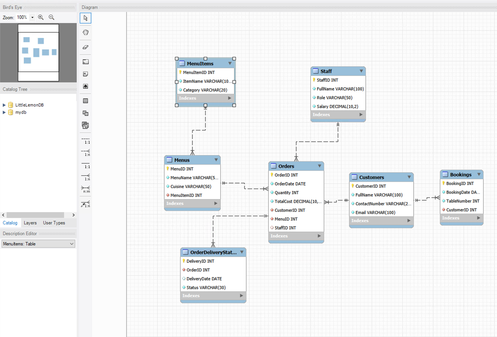

# Little Lemon database capstone

A booking and order database for the Little Lemon restaurant, built in MySQL,
with sales charts in Tableau and a Python client.

## What is in this repository

| Part | Files |
|---|---|
| Data model | `LittleLemonDM.mwb`, `LittleLemonDM.png` |
| Database export | `LittleLemonDB.sql` |
| Sample data | `02_data.sql` |
| Sales reports | `03_task1_orders_view.sql`, `03_task2_orders_over_150.sql`, `03_task3_menus_any.sql` |
| Order procedures | `04_task1_get_max_quantity.sql`, `04_task2_get_order_detail.sql`, `04_task3_cancel_order.sql` |
| Table bookings | `05_task1_bookings_data.sql`, `05_task2_check_booking.sql`, `05_task3_add_valid_booking.sql` |
| Booking procedures | `06_task1_add_booking.sql`, `06_task2_update_booking.sql`, `06_task3_cancel_booking.sql`, `06_manage_booking.sql` |
| Tableau workbook and its data | `littlelemon.twb`, `LittleLemon_Data.xlsx` |
| Python client | `little_lemon_client.ipynb` |
| Results | `screenshots/`, one image per task, named like the file it belongs to |

## Data model

Seven tables: `Customers`, `Bookings`, `Orders`, `OrderDeliveryStatus`,
`Menus`, `MenuItems` and `Staff`. The model was made in MySQL Workbench and
deployed with Forward Engineer as `LittleLemonDB`.

## Stored procedures

| Procedure | File | What it does |
|---|---|---|
| `GetMaxQuantity()` | `04_task1_get_max_quantity.sql` | Returns the largest quantity in any order |
| `CancelOrder(order id)` | `04_task3_cancel_order.sql` | Deletes an order |
| `CheckBooking(date, table)` | `05_task2_check_booking.sql` | Says whether a table is already booked on a date |
| `AddValidBooking(date, table)` | `05_task3_add_valid_booking.sql` | Books a table in a transaction, rolls back if it is taken |
| `ManageBooking(date, table)` | `06_manage_booking.sql` | Reports whether a table is free on a date |
| `AddBooking(booking id, customer id, date, table)` | `06_task1_add_booking.sql` | Adds a booking |
| `UpdateBooking(booking id, date)` | `06_task2_update_booking.sql` | Moves a booking to another date |
| `CancelBooking(booking id)` | `06_task3_cancel_booking.sql` | Removes a booking |

`GetOrderDetail` in `04_task2_get_order_detail.sql` is a prepared statement
that lists the orders of one customer.

## Running it

1. Create the database from `LittleLemonDB.sql`, or forward engineer the model.
2. Run `02_data.sql`.
3. Run the numbered scripts in order. Each one ends with an example call.

The Python notebook connects as the database user `littlelemon`, which exists
only on the local server for this project. It lists the tables, runs a join
query and calls `GetMaxQuantity` and `ManageBooking`.

## Tableau

`littlelemon.twb` uses the United States rows of the Little Lemon sales data
and has four sheets and a dashboard: Customers sales, Profit chart, Sales
Bubble Chart, Cuisine Sales and Profits.
